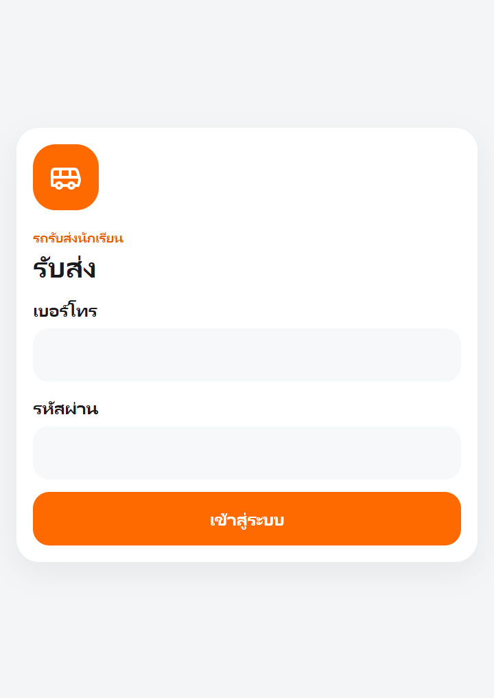
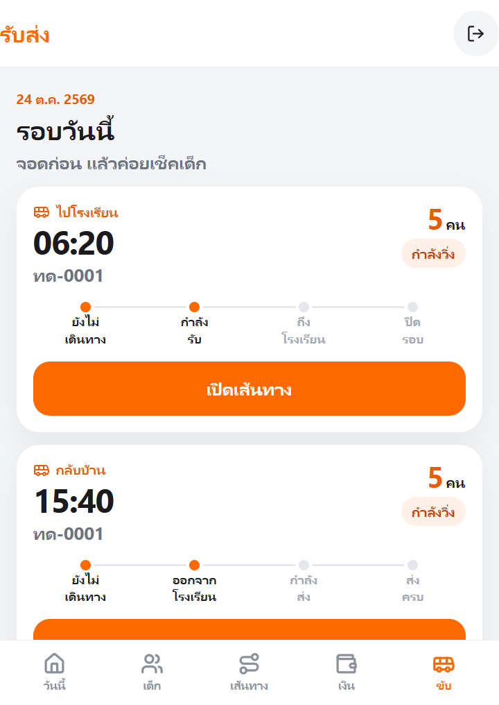
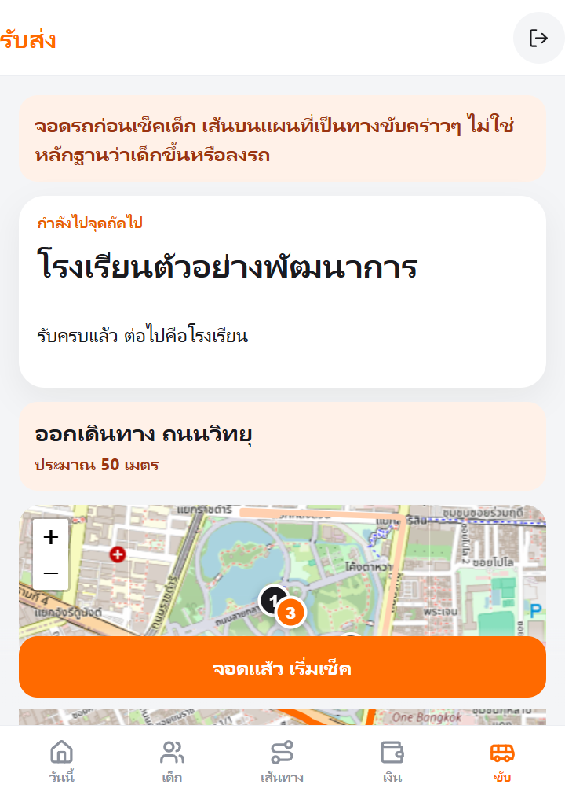
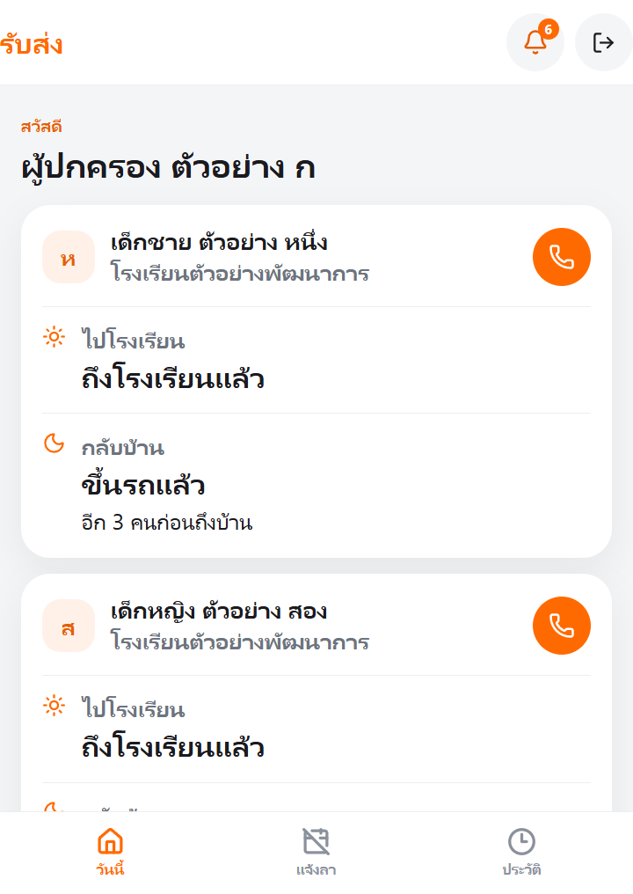
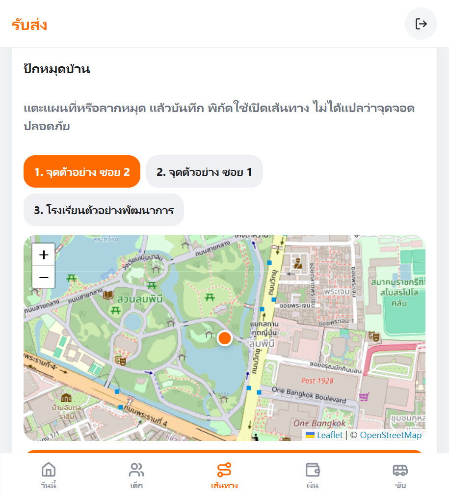

# รับส่ง

ระบบรับส่งนักเรียนสำหรับรถตู้ที่เจ้าของขับเอง เปิดบนมือถือได้ทันที ไม่ต้องติดตั้งจากร้านแอป

คนขับดูจุดถัดไปบนแผนที่ในแอป แล้วจอดเพื่อยืนยันเด็กทีละคน ผู้ปกครองเห็นเฉพาะลูกของตน พร้อมจำนวนคนที่ยังเหลือก่อนถึงโรงเรียนหรือถึงบ้าน

รีโพซิทอรีนี้เป็นส่วนตัวเพราะเก็บข้อมูลเด็ก ภาพด้านล่างมาจากข้อมูลตัวอย่างที่เป็นบุคคลสมมติ

## หน้าตาของระบบ

<table>
  <tr>
    <td width="33%" align="center">
      <br>
      <b>เข้าสู่ระบบ</b><br>
      เบอร์โทรกับรหัสผ่าน แยกสิทธิ์คนขับและผู้ปกครอง
    </td>
    <td width="33%" align="center">
      <br>
      <b>รอบวันนี้</b><br>
      รอบเช้าและรอบเย็นอยู่การ์ดละใบ กดเปิดเส้นทางได้ทันที
    </td>
    <td width="33%" align="center">
      <br>
      <b>ไปจุดถัดไป</b><br>
      เส้นสีส้ม ทางเลี้ยว และชื่อจุดอยู่ในแอปนี้
    </td>
  </tr>
  <tr>
    <td width="33%" align="center">
      <br>
      <b>ผู้ปกครอง</b><br>
      เห็นเฉพาะลูกของตน ถ้ายังมีจุดอื่นจะขึ้นเป็นจำนวนคน
    </td>
    <td width="33%" align="center">
      <br>
      <b>ปักหมุดบ้าน</b><br>
      แตะแผนที่เพื่อจำตำแหน่งจุดรับ แล้วใช้เปิดเส้นทาง
    </td>
    <td width="33%"></td>
  </tr>
</table>

## หนึ่งรอบทำงานอย่างไร

1. คนขับเปิดรอบของวันนี้ แผนที่เรียงจุดตามลำดับที่ระบบจัดไว้
2. ถึงจุดแล้วจอด กดยืนยันเด็กในจุดนั้นทีละคน
3. เมื่อเช็คครบที่บ้านนั้น แอปเลื่อนไปจุดถัดไปเอง พร้อมเส้นทางและทางเลี้ยว ไม่ออกไปแอปแผนที่อื่น
4. ผู้ปกครองได้รับการแจ้งในแอปเมื่อเซิร์ฟเวอร์บันทึกแล้ว และเห็นเฉพาะสถานะของลูกตน

ระยะทางกับทางเลี้ยวเป็นค่าประมาณจากข้อมูลถนน ไม่ได้รับประกันเวลาถึง เส้นบนแผนที่ไม่ได้เป็นหลักฐานว่าเด็กขึ้นหรือลงรถ และหมุดไม่ได้แปลว่าจุดจอดหรือทางเข้าปลอดภัย

## สิ่งที่ระบบทำได้ตอนนี้

- เข้าสู่ระบบและแยกสิทธิ์คนขับกับผู้ปกครอง เจ้าของที่ขับเองใช้บทบาทคนขับ
- ตารางรอบเช้าและรอบเย็น รายชื่อเรียงตามจุด และภาพหยุดของรอบที่ออกแล้วไม่ถูกแก้เงียบ ๆ
- แผนที่ในแอป ทางเลี้ยวไปจุดถัดไป และปักหมุดจุดรับจากแผนที่
- บันทึกรับขึ้นรถ ส่งถึงจุดหมาย เด็กไม่อยู่ ผู้ปกครองแจ้งหยุด รถล่าช้า และผู้รับที่ได้รับอนุญาต
- ตรวจความพร้อมก่อนออก ตรวจว่าเด็กลงครบ และตรวจว่ารถว่างก่อนปิดรอบ
- ผู้ปกครองแจ้งหยุด ดูประวัติ และเห็นจำนวนคนที่เหลือโดยไม่เห็นชื่อเด็กคนอื่น
- แจ้งในแอปเมื่อเซิร์ฟเวอร์บันทึกแล้ว และบอกตรง ๆ ว่าพุชยังไม่ได้ตั้งค่า
- คิวออฟไลน์ที่ยังไม่ขึ้นว่าสำเร็จจนกว่าเซิร์ฟเวอร์ยืนยัน
- จัดการนักเรียน บัญชี จุดรับส่ง รถ วันหยุด ค่าโดยสารแบบบันทึกเอง และประวัติการแก้ไข

## สิ่งที่ยังไม่พร้อมใช้กับเด็กจริง

- ยังไม่มีแอปใน App Store หรือ Play Store และยังไม่ได้ติดตั้งบนเซิร์ฟเวอร์จริง
- พุชและ SMS ยังไม่ส่งจนกว่าจะมีบัญชีของผู้ให้บริการเอง
- ยังไม่มีเกตเวย์รับเงิน
- แผนที่กับเส้นทางตอนพัฒนาใช้ข้อมูล OpenStreetMap เพื่อดูงานบนเครื่องตัวเอง ระบบจริงต้องตั้งเซิร์ฟเวอร์แผนที่และเซิร์ฟเวอร์เส้นทางของเราเอง อย่าใส่เซิร์ฟเวอร์สาธารณะเป็นค่าเริ่มต้น
- คำขอเส้นทางส่งเฉพาะพิกัด ไม่ส่งชื่อเด็กหรือที่อยู่
- ถ้าคำนวณเส้นทางไม่ได้ ระบบจะบอกว่ายังไม่มีเส้น และจะไม่แต่งเวลาขึ้นมาเอง
- การยืนยันว่าจอดแล้วเป็นปุ่มบนหน้าจอ ไม่ได้ตรวจจากเซ็นเซอร์รถ
- อิมเมจ Docker มีไฟล์ให้สร้าง แต่ยังไม่ได้พิสูจน์การรันบนโฮสต์จริง

รายละเอียดเพิ่มอยู่ใน `docs/REQUIREMENTS.md`, `docs/WORKFLOW.md`, `docs/ARCHITECTURE.md`, `docs/ASSUMPTIONS.md`, `docs/SECURITY.md`, `docs/DATA.md`, `docs/MAPS.md` และ `docs/MIGRATION.md`

## เทคโนโลยี

Next.js, React, TypeScript, PostgreSQL 16 พร้อม PostGIS 3.4, Prisma และ Vitest เหตุผลอยู่ใน `docs/ARCHITECTURE.md` และ `docs/MAPS.md`

## ติดตั้งเพื่อพัฒนา

ต้องมี Node.js 22 ขึ้นไป, npm และ Docker Desktop

```powershell
cd $HOME\Projects\rab-song
copy .env.example .env
```

แก้ `SESSION_SECRET` ใน `.env` ให้เป็นข้อความสุ่มยาวอย่างน้อย 32 ตัว แล้วเปิดฐานข้อมูล

```powershell
docker compose up -d
npm install
npx prisma migrate deploy
npm run db:seed
npm run dev
```

เปิด http://localhost:3000

พอร์ตฐานพัฒนาคือ **5436** และฐานทดสอบคือ **5437** เพื่อไม่ไปชน Postgres อื่นบนเครื่อง

### บัญชีตัวอย่าง

ใช้ได้หลัง `npm run db:seed` และเฉพาะเมื่อ `APP_ENV=development` กับ `SEED_DATASET=development`

| บทบาท | เบอร์ | รหัส |
| --- | --- | --- |
| คนขับ | 0800000001 | DevOwner#2569 |
| ผู้ปกครอง ก | 0800000002 | DevGuard#2569 |
| ผู้ปกครอง ข | 0800000003 | DevGuard#2569 |

คำสั่ง seed ลบข้อมูลในฐานที่ชี้ไว้ จึงปฏิเสธถ้าไม่ใช่สภาพแวดล้อมพัฒนา หรือถ้าระบุฐานที่ไม่ใช่ localhost

## ทดสอบและบิลด์

```powershell
npm test
npm run build
```

เทสครอบคลุมการเข้าสู่ระบบ สิทธิ์ การยืนยันรับส่ง การแจ้งหยุด การกดซ้ำ และการซิงก์ ตัวรันเทสบังคับใช้ฐาน `rabsong_test` ที่พอร์ต 5437 แม้เครื่องจะตั้ง `DATABASE_URL` ไว้เป็นฐานพัฒนา จึงไม่ลบข้อมูลตัวอย่างบนพอร์ต 5436

## ขึ้นระบบจริง

1. ตั้ง PostgreSQL ที่ไม่ใช่รหัสในไฟล์ตัวอย่าง
2. ตั้งค่าเหล่านี้บนโฮสต์

```text
APP_ENV=production
DATABASE_URL=postgresql://...
SESSION_SECRET=ข้อความสุ่มยาวอย่างน้อย 32 ตัว
OWNER_NAME=ชื่อเจ้าของ
OWNER_PHONE=08xxxxxxxx
OWNER_PASSWORD=รหัสยาวอย่างน้อย 10 ตัว และห้ามใช้รหัสตัวอย่าง
```

3. รันบน staging ที่ใช้ฐานแยกจากของจริง ตรวจเข้าสู่ระบบ สิทธิ์ผู้ปกครอง ปิดรอบ และข้อความว่าเส้นทางยังคำนวณไม่ได้
4. วาง reverse proxy ที่ทำ HTTPS ไว้หน้าแอป อย่าเปิดพอร์ตฐานข้อมูลออกอินเทอร์เน็ต
5. สำรองฐานก่อน migrate ด้วย `scripts/backup-db.ps1` แล้วเก็บไฟล์ไว้นอกเครื่อง
6. ดูล็อกของแอปและฐานเมื่อเปิดใช้ ยังไม่มีตัวเฝ้าระวังภายนอกในรีโพซิทอรีนี้

ก่อนใช้กับเด็กจริง ผู้ดูแลต้องตรวจเองว่ามีผู้รับผิดชอบข้อมูล มีหนังสือยินยอม จำกัดคนที่เข้าถึงฐาน มีสำรองข้อมูล และไม่ได้ใช้บัญชีตัวอย่าง ระบบนี้ยังไม่ได้ติดตั้งบน staging หรือ production

```powershell
npx prisma migrate deploy
npm run owner:create
npm run build
npm start
```

ห้ามรัน `npm run db:seed` บนระบบจริง คำสั่งจะปฏิเสธถ้า `APP_ENV` ไม่ใช่ `development`

ถ้าจะทำอิมเมจ ให้ใช้ `Dockerfile` แล้วส่ง environment ตอนรันคอนเทนเนอร์ ยังไม่ได้พิสูจน์การรันอิมเมจนี้บนเซิร์ฟเวอร์

การแจ้งในแอปบันทึกเมื่อเหตุการณ์สำเร็จ พุชและ SMS จะขึ้นว่ายังไม่ได้ตั้งค่าจนกว่าจะมี URL กับคีย์ของผู้ให้บริการเอง ข้อความที่ส่งออกไปเป็นข้อความทั่วไป ไม่ใส่ชื่อเด็กหรือที่อยู่

## งานกับ Git

`main` คือสายที่รันได้ การเปลี่ยนแปลงเข้าผ่าน pull request จาก branch `feat/*`
